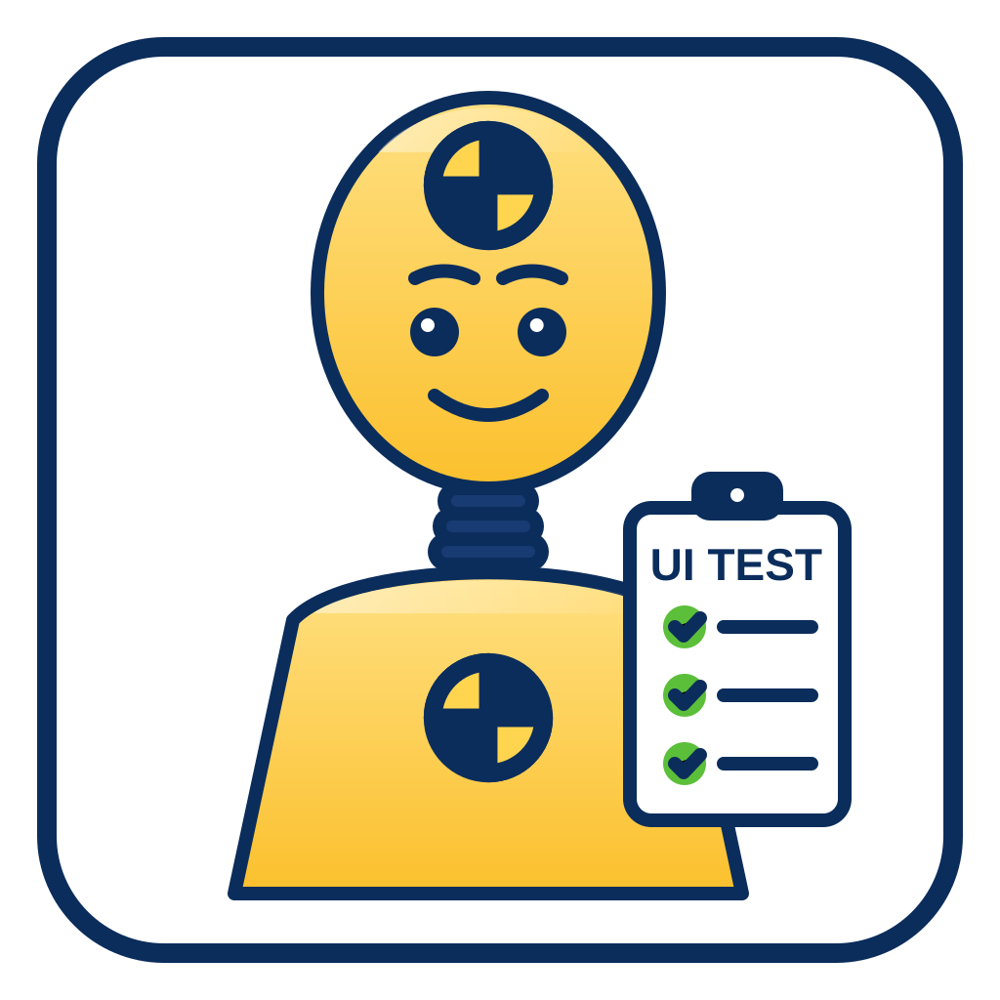

<p align="center">
  
</p>

<h1 align="center">TestDummy</h1>

<p align="center">
  A .NET MAUI sample/test application used as a driver app for <strong>UITestForge</strong>.
</p>

## About

TestDummy is a lightweight .NET MAUI application built to exercise and validate UI automation
scenarios for UITestForge. It targets multiple platforms (Android, iOS, MacCatalyst, and Windows)
provides a set of sample pages/controls that automated tests can interact with.

The app uses a Shell (`AppShell`) and contains these pages:

- `MainPage08`, `MainPage09`, `MainPage10` – sample pages with images/controls (SVG and PNG)
- `InfoPage` – information page

## Getting Started

### Prerequisites

- Visual Studio 2022/2026 with the **.NET MAUI** workload installed
- .NET 10 SDK

### Build & Run

1. Clone the repository:
   ```powershell
   https://github.com/ZeProgFactory/TestDummy.git
   ```
2. Open `TestDummy.slnx` in Visual Studio.
3. Select a target platform (Android, iOS, MacCatalyst, or Windows) and press **Run**.

Alternatively, from the command line:
```powershell
dotnet build Maui/TestDummy.Maui.csproj -f net10.0-windows10.0.19041.0
```

## DevFlow Agent

The app references the `Microsoft.Maui.DevFlow.Agent` NuGet package (`0.1.0-preview.13.26526.5`).
The agent is registered in `Maui/MauiProgram.cs` via `builder.AddMauiDevFlowAgent()` and is only
enabled in **Debug** builds (`#if DEBUG`), allowing external tooling to inspect and drive the running app.

### DevFlow CLI

The agent is driven by the `maui` CLI (`dotnet tool install -g Microsoft.Maui.Cli --prerelease`).
Start the app in Debug, then:

```powershell
# Check health / connection
maui devflow diagnose
maui devflow list
maui devflow ui status

# Dump the visual tree
maui devflow ui tree
maui devflow ui tree --depth 3 --format compact

# Find elements
maui devflow ui query --text "Click me"

# Tap an element (by id, AutomationId or text)
maui devflow ui tap <elementId>
maui devflow ui tap --automationId MyButton
maui devflow ui tap --text "Click me" --and-screenshot

# Fill text into an input
maui devflow ui fill --automationId MyEntry "Hello"

# Navigate to a Shell route
maui devflow ui navigate "//MainPage09"

# Screenshot
maui devflow ui screenshot --output screen.png --overwrite

# Logs
maui devflow logs
```

Run `maui devflow commands` or `maui devflow ui --help` for the full list. Use `-p <platform>`
(`android`, `ios`, `maccatalyst`, `windows`) or `-ap <port>` to select the target agent.

### UI Tests

[UITestForge](https://github.com/ZeProgramFactory/UITestForge) can be used to write automated UI tests
against this app through the DevFlow agent.

## Project Structure

| Path | Description |
|------|--------------|
| `Maui/` | .NET MAUI project source |
| `Maui/TestDummy.Maui.csproj` | MAUI project file (net10.0 android, ios, maccatalyst, windows) |
| `Maui/App.xaml`, `Maui/AppShell.xaml` | Application and Shell definitions |
| `Maui/MainPage08/09/10.xaml`, `Maui/InfoPage.xaml` | Sample pages |
| `Maui/MauiProgram.cs` | App bootstrap and configuration |
| `Maui/Resources/AppIcon` | Application icon assets |
| `Maui/Resources/Images` | Sample images used across pages |
| `Maui/Resources/Styles` | Colors and styles |
| `Maui/Platforms` | Platform-specific code (Android, iOS, MacCatalyst, Windows) |

## Contributing

Issues and pull requests are welcome. Please open an issue to discuss any significant changes
before submitting a PR.

## License

See [LICENSE](LICENSE) for details.
